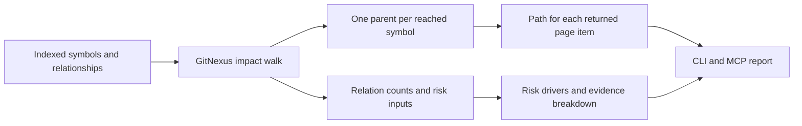

# ImpactLens

**A clearer answer to “what might this code change affect?”**

ImpactLens is a standalone, explainable impact-analysis project built on
[GitNexus](https://github.com/abhigyanpatwari/GitNexus). It follows code
relationships through a repository and shows the evidence behind each reported
dependency and risk label. The CLI and MCP tool remain named `gitnexus` so the
existing indexing and editor integrations continue to work.

`GRAPH PATHS` · `RISK DRIVERS` · `CALLS VS IMPORTS`

## The problem

A list of affected symbols is useful, but it leaves two review questions open:

1. **Why is this symbol in the result?** A caller two steps away should have a
   trace back to the target.
2. **Why is the risk HIGH or MEDIUM?** A reviewer should see the observed count
   and threshold, and whether the direct fanout is made of calls or file imports.

GitNexus already builds the code graph and computes impact. This project adds
an explanation layer to that existing walk. It does not claim that a graph edge
proves a change will break a caller.

## What the report adds

| Field | What it answers |
| --- | --- |
| `riskDrivers` | Which observed count crossed the threshold for the primary risk label? |
| `evidenceBreakdown` | How many reached symbols came through `CALLS`, `IMPORTS`, and other relation types? |
| `evidencePath` | Which representative chain connects this result to the target? |

For example, an exported interface with eight importing files produces a
MEDIUM score under the existing rule, with a direct fanout of eight `IMPORTS`
edges. A path can then show that the walk entered the interface's owning file
before it reached a route file:

```text
Interface:Options --DEFINES (seed)-- File:options.ts <--IMPORTS-- File:route.ts
Risk: MEDIUM
Why: direct 8 ≥ 5
Direct evidence: IMPORTS 8
```

The `DEFINES (seed)` step is an internal expansion, not a dependency edge.
`IMPORTS` shows that the route imports the file; it does **not** prove that the
route uses `Options`. That distinction is the point of the report.

## How it works



The existing breadth-first walk chooses one deterministic edge for each reached
symbol. ImpactLens keeps that edge's parent, reconstructs a path only for items
on the returned page, and marks reversed upstream edges. The summary counts are
available even when `summaryOnly` omits the symbol list. No new graph query is
needed for the explanation.

## Try it from source

Requires Node.js 22.18+ or 24.11+. Build the CLI from this repository:

```bash
npm ci --prefix gitnexus
npm run build --prefix gitnexus
```

Then, from the codebase you want to inspect, run the built CLI. Replace
`/absolute/path/to/ImpactLens` with the location of this checkout:

```bash
cd /path/to/codebase
node /absolute/path/to/ImpactLens/gitnexus/dist/cli/index.js analyze --index-only
node /absolute/path/to/ImpactLens/gitnexus/dist/cli/index.js impact UserService --direction upstream
```

The same report fields are returned by the `impact` MCP tool after connecting
the local GitNexus server. For the web graph explorer, start the backend with
`npm run serve --prefix gitnexus`, then install and run the web client with
`npm ci --prefix gitnexus-web` and `npm run dev --prefix gitnexus-web`.

## Verification

The change adds unit tests for threshold explanations and path reconstruction,
plus database-backed cases for a direct caller, a transitive caller, and an
interface reached through its owning file. The broader impact suite currently
passes **779 tests across 37 files**. See
[the design note](docs/fork/explainable-impact.md) for output details and known
limits.

## Scope and limits

- A path is one deterministic **witness**, not every possible route through the
  graph.
- A file import is weaker evidence than direct symbol use. The existing risk
  formula is unchanged; the report makes its inputs visible.
- Missing or truncated graph information is still governed by GitNexus's
  `partial`, `epistemic`, `riskScale`, and `riskNote` warnings.
- The visual identity in the web client is customized for this repository. The
  CLI package name, data model, and analysis engine remain GitNexus-compatible.

## Origin and license

This is a standalone derivative based on
[`abhigyanpatwari/GitNexus`](https://github.com/abhigyanpatwari/GitNexus) at
commit `ea97d6d`. GitNexus was created by Abhigyan Patwari and contributors.
Their history and the original **PolyForm Noncommercial 1.0.0** license are
retained. ImpactLens is not an official GitNexus release.
